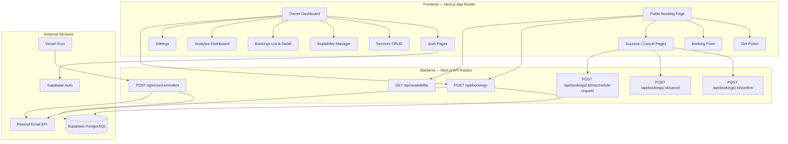
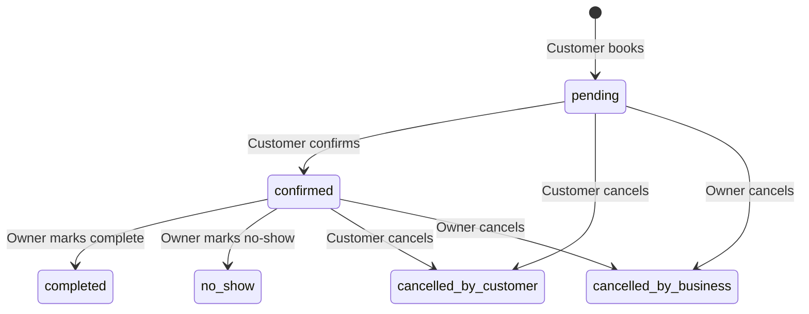

# NoShowGuard — MVP Project Plan

## Overview
NoShowGuard is a SaaS that helps local service businesses (tutors, salons, gyms, photographers, consultants) reduce appointment no-shows through automated booking management and email reminders.

## Architecture



## Build Stages

| # | Stage | Description | Status |
|---|-------|-------------|--------|
| 1 | **Foundation** | Project plan, folder structure, DB schema, env vars, README skeleton | **Completed** ✅ |
| 2 | **Auth & Onboarding** | Supabase Auth, signup/login, business profile creation | **Completed** ✅ |
| 3 | **Services CRUD** | Create, edit, toggle services | **Completed** ✅ |
| 4 | **Availability Rules** | Weekly schedule management per business | **Completed** ✅ |
| 5 | **Public Booking Flow** | Slug-based booking page, slot generation, double-booking prevention | **Completed** ✅ |
| 6 | **Email System** | Resend integration, confirmation/reminder/cancellation templates | **Completed** ✅ |
| 7 | **Reminder Cron** | Scheduled job for 24h and 2h reminders | **Completed** ✅ |
| 8 | **Owner Dashboard** | Booking management, status updates | **Next Up** |
| 9 | **Analytics** | Revenue, no-show rate, confirmation rate | Pending |
| 10 | **Polish & Deploy** | README, seed data, deployment config | Pending |

## Folder Structure

```
noshow-guard/
├── public/
├── src/
│   ├── app/
│   │   ├── (auth)/
│   │   │   ├── login/
│   │   │   │   └── page.tsx
│   │   │   ├── signup/
│   │   │   │   └── page.tsx
│   │   │   └── layout.tsx
│   │   ├── (dashboard)/
│   │   │   ├── dashboard/
│   │   │   │   └── page.tsx
│   │   │   ├── services/
│   │   │   │   └── page.tsx
│   │   │   ├── availability/
│   │   │   │   └── page.tsx
│   │   │   ├── bookings/
│   │   │   │   ├── [id]/
│   │   │   │   │   └── page.tsx
│   │   │   │   └── page.tsx
│   │   │   ├── settings/
│   │   │   │   └── page.tsx
│   │   │   └── layout.tsx
│   │   ├── book/
│   │   │   └── [slug]/
│   │   │       ├── success/
│   │   │       │   └── page.tsx
│   │   │       └── page.tsx
│   │   ├── booking/
│   │   │   └── [token]/
│   │   │       ├── cancel-success/
│   │   │       │   └── page.tsx
│   │   │       └── page.tsx
│   │   ├── api/
│   │   │   ├── bookings/
│   │   │   │   ├── [id]/
│   │   │   │   │   ├── confirm/
│   │   │   │   │   │   └── route.ts
│   │   │   │   │   ├── cancel/
│   │   │   │   │   │   └── route.ts
│   │   │   │   │   └── reschedule-request/
│   │   │   │   │       └── route.ts
│   │   │   │   └── route.ts
│   │   │   ├── availability/
│   │   │   │   └── route.ts
│   │   │   └── cron/
│   │   │       └── reminders/
│   │   │           └── route.ts
│   │   ├── layout.tsx
│   │   ├── page.tsx
│   │   └── globals.css
│   ├── components/
│   │   ├── ui/                    # Reusable UI primitives
│   │   ├── dashboard/             # Dashboard-specific components
│   │   ├── booking/               # Booking flow components
│   │   └── emails/                # Email templates (React Email)
│   ├── lib/
│   │   ├── supabase/
│   │   │   ├── client.ts          # Browser Supabase client
│   │   │   ├── server.ts          # Server Supabase client
│   │   │   ├── admin.ts           # Service-role Supabase client
│   │   │   └── middleware.ts      # Auth middleware helper
│   │   ├── resend.ts              # Resend client
│   │   ├── email.ts               # Email sending functions
│   │   ├── slots.ts               # Slot generation logic
│   │   ├── tokens.ts              # Token generation/validation
│   │   ├── timezone.ts            # Timezone utilities
│   │   └── constants.ts           # App-wide constants
│   ├── types/
│   │   ├── database.ts            # Supabase generated types
│   │   └── index.ts               # App-level types
│   └── validations/
│       ├── booking.ts             # Booking form validation
│       ├── service.ts             # Service form validation
│       └── business.ts            # Business form validation
├── supabase/
│   └── migrations/
│       └── 001_initial_schema.sql
├── .env.example
├── .env.local                     # (gitignored)
├── middleware.ts                   # Next.js middleware for auth
├── next.config.ts
├── tailwind.config.ts
├── tsconfig.json
├── package.json
├── vercel.json
└── README.md
```

## Database Schema (Summary)

| Table | Purpose |
|-------|---------|
| `businesses` | Business profiles linked to auth users |
| `services` | Services offered by each business |
| `availability_rules` | Weekly availability schedule |
| `bookings` | Customer bookings with status tracking |
| `booking_events` | Audit log of all booking state changes |

## Booking Status State Machine



## Key Design Decisions

1. **Confirmation tokens** — Each booking gets a `crypto.randomUUID()` token used in email links. No guessable IDs exposed.
2. **UTC storage** — All `starts_at_utc` / `ends_at_utc` stored in UTC. Displayed using the business's `timezone` field.
3. **Slot generation** — Computed at query time from `availability_rules` minus existing bookings. No slot table needed.
4. **Double-booking prevention** — PostgreSQL `EXCLUDE` constraint and unique slot index on `(business_id, service_id, starts_at_utc)`.
5. **Row Level Security** — Every table has RLS policies. Business owners can only access their own data. Public routes use the service-role client with explicit filters.
6. **Reschedule = Cancel + Rebook** — MVP keeps it simple. Original booking cancelled, customer redirected to booking page with service preselected.
